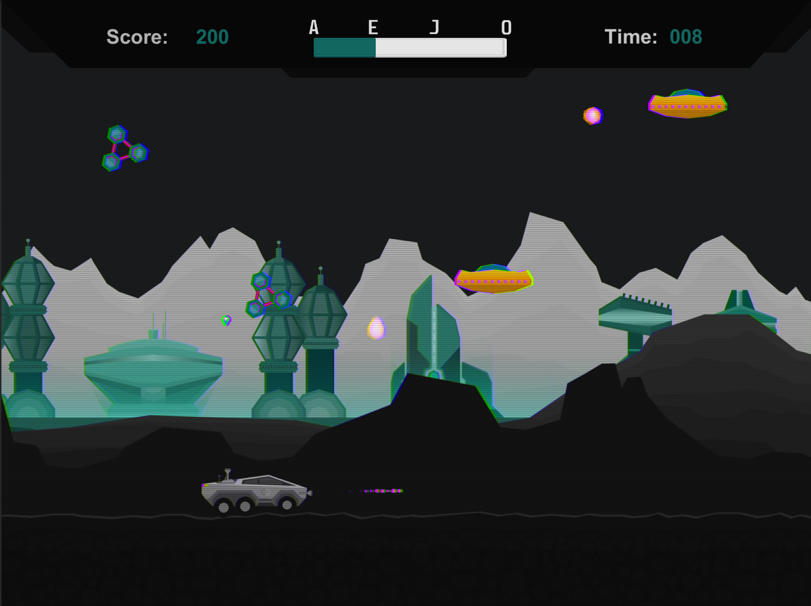
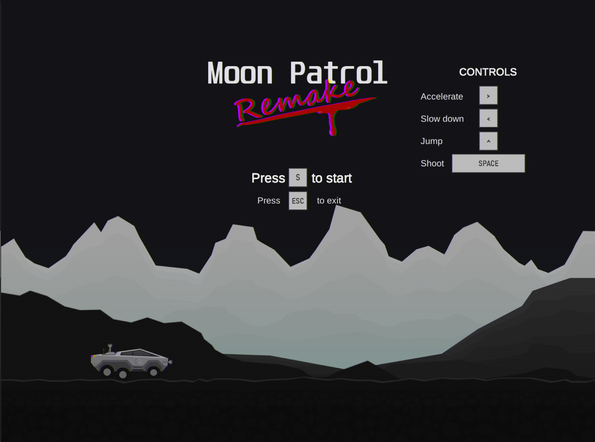
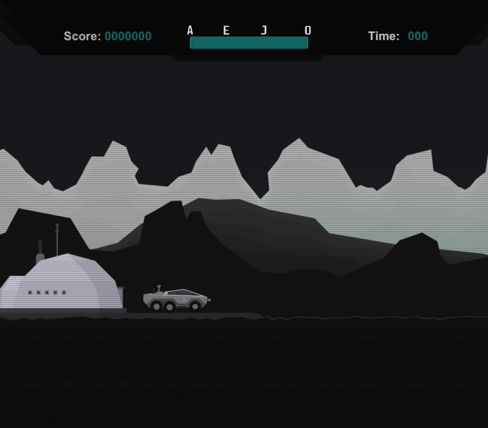
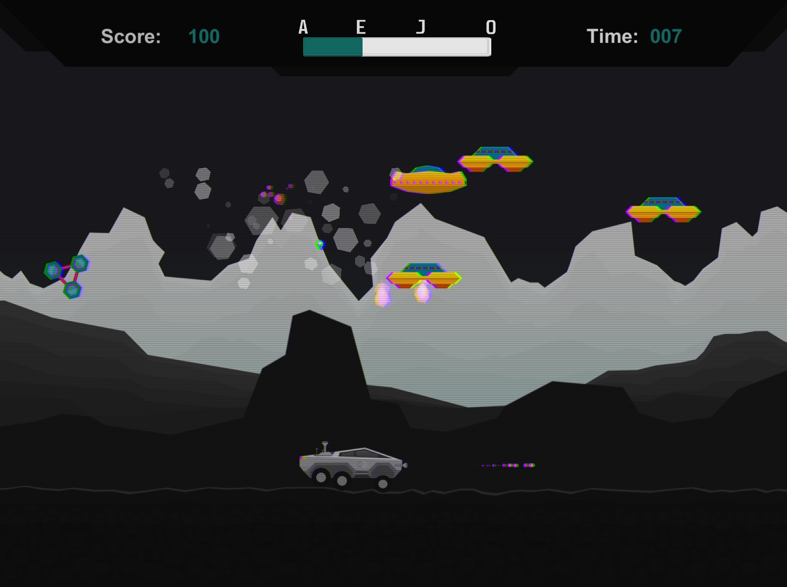

<h1 align="center">Moon Patrol Remake</h1>

<b>A 2D moon-buggy shooter in Unity.</b> 
A student remake of the 1982 arcade game Moon Patrol, made at Game Dev School in 2021 and later updated to Unity 6.

  
  
  
  

  <a href="README.pl.md">Polski</a> · <b>English</b> ·
  <a href="#quick-start">Quick start</a> ·
  <a href="#screenshots">Screenshots</a> ·
  <a href="#features">Features</a> ·
  <a href="#controls">Controls</a> ·
  <a href="#for-developers">For developers</a> ·
  <a href="#team-and-credits">Team and credits</a>

Drive a lunar buggy across three stages, jump over craters and rocks, avoid mines and shoot UFOs in two directions. The game was created as a group project at Game Dev School and is a learning project. This repository continues it as a Unity 6 project.

## Quick start

There is no release and no build in this repository, so it is source only. To play it, open it in Unity:

1. Install the Unity editor version listed in [`ProjectSettings/ProjectVersion.txt`](ProjectSettings/ProjectVersion.txt).
2. Clone the repository and add the folder in Unity Hub.
3. Open [`Assets/Scenes/Menu/StartMenuv2.0.unity`](Assets/Scenes/Menu/StartMenuv2.0.unity) and press Play.

The original 2021 team published a WebGL build of their version (historical, not this code): [original team's web build](https://patryk-rozwadowski.github.io/Moon-Patrol-Remake/).

## Screenshots

  

<table>
  <tr>
    <td align="center"> Main menu</td>
    <td align="center"> Start of a stage</td>
    <td align="center"> UFO wave</td>
  </tr>
</table>

Screenshots date from the original 2021 version.

## Features

- **Three stages** — the course is split into stages A–E, E–J and J–O. Letter checkpoints and a progress bar in the HUD show where you are.
- **Stage summaries** — each stage ends with a summary screen. There are also game over and game finished screens.
- **Two-way shooting** — one shot fires a bullet forward and one upward.
- **Jumping** — the buggy jumps over craters, holes and rocks; jumping over obstacles gives score.
- **Obstacles** — big and small rocks, holes, double-jump holes and mines.
- **UFO waves** — three kinds of UFOs attack in waves, with bombs and rockets.
- **Score and time** — the HUD shows the score and the stage time.
- **Retro look** — layered parallax background, CRT-style screen shaders and sound effects with music.

## Controls

| Key | Action |
| --- | --- |
| Right arrow | Accelerate |
| Left arrow | Slow down |
| Up arrow | Jump |
| Space | Shoot |
| S | Start the game (menu) |
| Esc | Exit |

## For developers

- **Engine:** Unity 6 (version in [`ProjectSettings/ProjectVersion.txt`](ProjectSettings/ProjectVersion.txt)), 2D, built-in render pipeline, C#.
- **Scenes:** the menu, the three stages and the summary screens are in `Assets/Scenes/`. They are registered in `ProjectSettings/EditorBuildSettings.asset`.
- **Input:** the game reads keys through the legacy Input Manager, with keys stored in a ScriptableObject. The Input System package 1.20.0 is installed and Active Input Handling is set to Both.

<b>Refactor proposal</b>

&nbsp;

The [`Refactor/`](Refactor) folder lies outside `Assets/`, so Unity does not compile it. It contains a code review in Polish, [`Refactor/ANALYSIS.md`](Refactor/ANALYSIS.md), and a proposal of refactored scripts (Input System based input, events instead of `GameObject.Find`, object pooling, fixes for listed bugs). According to the analysis, the refactored scripts compile, but the game has not been run with the new code and the scenes and prefabs would need migration first. The game in `Assets/` still uses the original scripts.

## Team and credits

The project was created in 2020–2021 by team 5 of Game Dev School. Roles as listed in the original team's README:

- **Lead programmer** — Patryk Rozwadowski
- **Lead graphic designer** — Daniel Pytel
- **Game designers** — Michał Antosiewicz, Magda Kowalska, Paweł J. Rodan

The original team's repository is [Patryk-Rozwadowski/Moon-Patrol-Remake](https://github.com/Patryk-Rozwadowski/Moon-Patrol-Remake).

**Continuation in this repository.** Daniel Pytel updated the engine in 2025, then upgraded the project to Unity 6, added the Input System package and wrote the code analysis and refactoring proposal in `Refactor/` (commits of 2026-09-28).

**Audio and fonts.** Sound effects and music are in [`Assets/Sounds`](Assets/Sounds); the repository does not document their authors, sources or licences. TextMesh Pro includes Liberation Sans under the SIL Open Font License ([`Assets/TextMesh Pro/Fonts/LiberationSans - OFL.txt`](<Assets/TextMesh Pro/Fonts/LiberationSans - OFL.txt>)).

**Licence.** This is a non-commercial student project. Moon Patrol is a 1982 arcade game and this remake is not affiliated with its rights holders; no licence from them is claimed.
