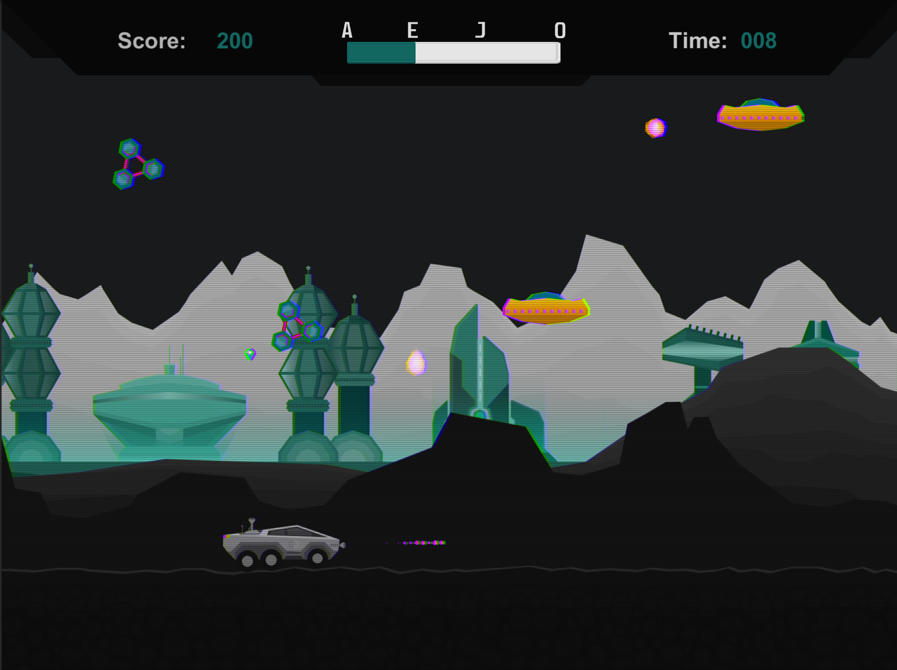
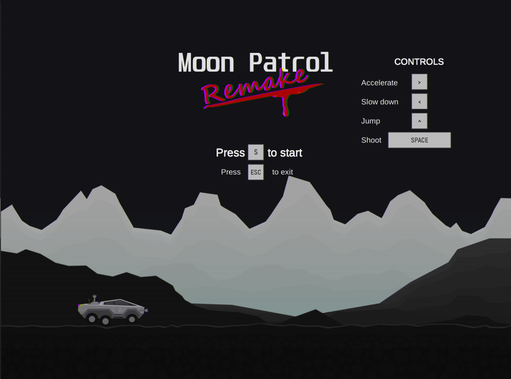
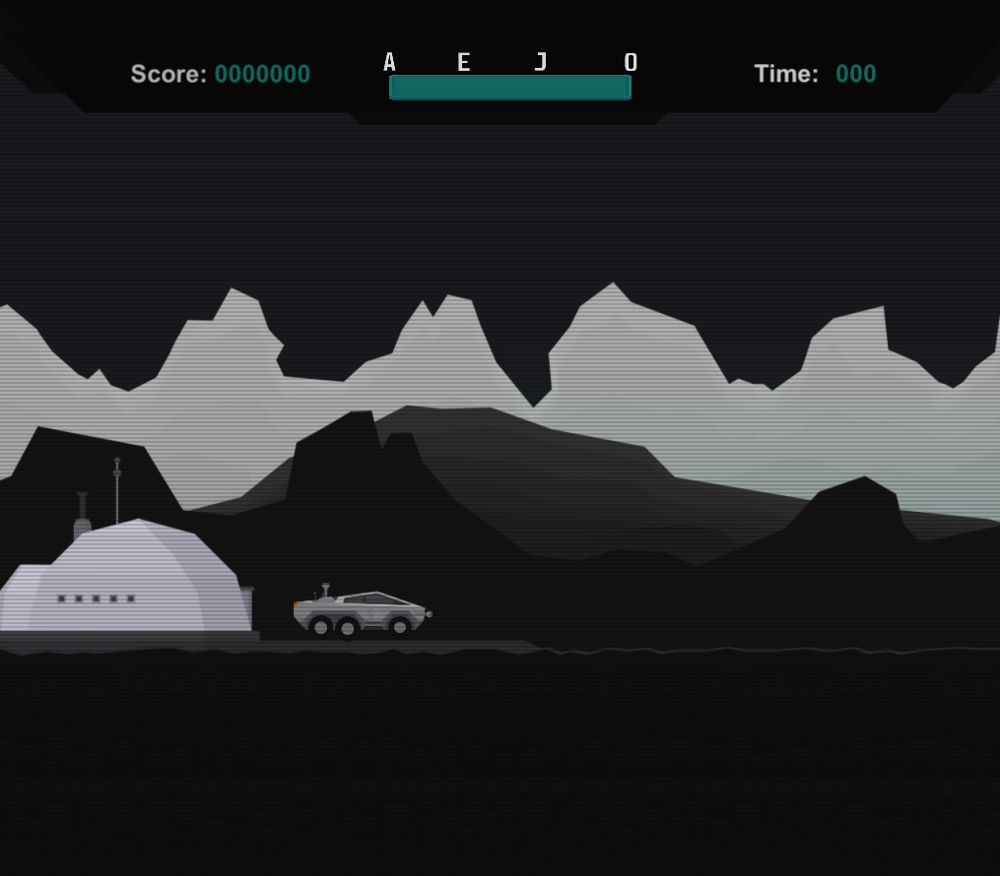
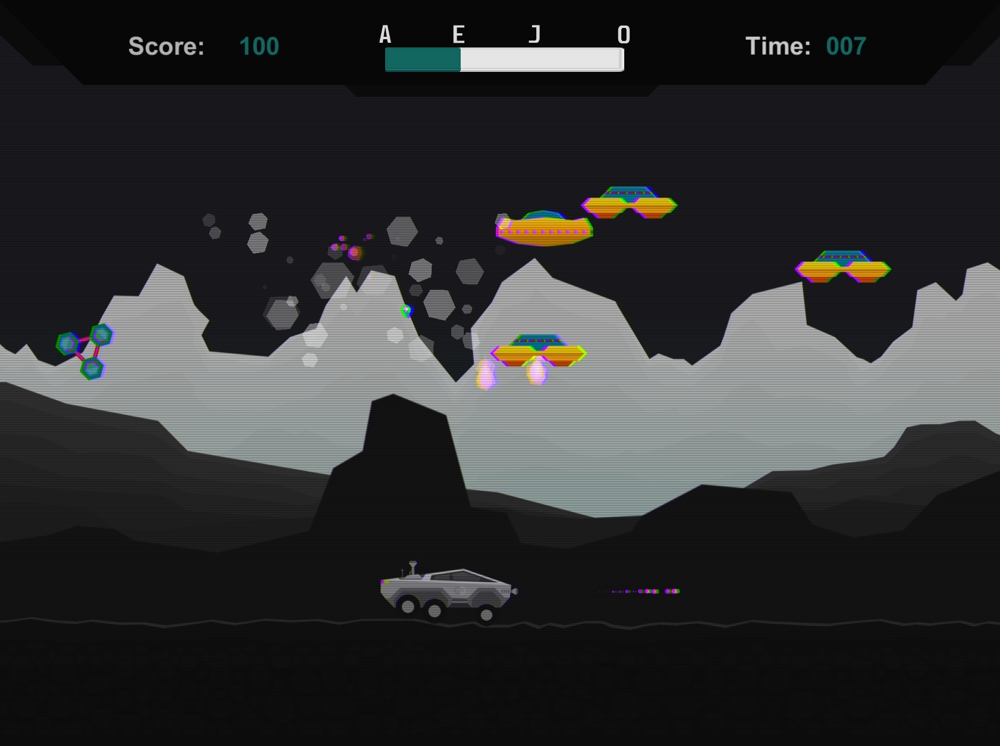

<h1 align="center">Moon Patrol Remake</h1>

<b>Dwuwymiarowa strzelanka z łazikiem księżycowym w Unity.</b> 
Studencki remake arcade'owej gry Moon Patrol z 1982 roku, stworzony w Game Dev School w 2021 roku i później zaktualizowany do Unity 6.

  
  
  
  

  <b>Polski</b> · <a href="README.md">English</a> ·
  <a href="#szybki-start">Szybki start</a> ·
  <a href="#zrzuty-ekranu">Zrzuty ekranu</a> ·
  <a href="#funkcje">Funkcje</a> ·
  <a href="#sterowanie">Sterowanie</a> ·
  <a href="#dla-programistów">Dla programistów</a> ·
  <a href="#zespół-i-autorstwo">Zespół i autorstwo</a>

Prowadź księżycowy łazik przez trzy etapy, przeskakuj kratery i skały, omijaj miny i strzelaj do UFO w dwóch kierunkach. Gra powstała jako projekt grupowy w Game Dev School i jest projektem edukacyjnym. To repozytorium kontynuuje ją jako projekt w Unity 6.

## Szybki start

W repozytorium nie ma wydania ani gotowego builda, więc udostępnione są tylko źródła. Aby zagrać, otwórz projekt w Unity:

1. Zainstaluj wersję edytora Unity podaną w [`ProjectSettings/ProjectVersion.txt`](ProjectSettings/ProjectVersion.txt).
2. Sklonuj repozytorium i dodaj folder w Unity Hub.
3. Otwórz [`Assets/Scenes/Menu/StartMenuv2.0.unity`](Assets/Scenes/Menu/StartMenuv2.0.unity) i uruchom grę przyciskiem Play.

Oryginalny zespół z 2021 roku opublikował build WebGL swojej wersji (historyczny, nie z tego kodu): [wersja webowa oryginalnego zespołu](https://patryk-rozwadowski.github.io/Moon-Patrol-Remake/).

## Zrzuty ekranu

  

<table>
  <tr>
    <td align="center"> Menu główne</td>
    <td align="center"> Początek etapu</td>
    <td align="center"> Fala UFO</td>
  </tr>
</table>

Zrzuty ekranu pochodzą z oryginalnej wersji z 2021 roku.

## Funkcje

- **Trzy etapy** — trasa jest podzielona na etapy A–E, E–J i J–O. Litery checkpointów i pasek postępu w HUD pokazują, w którym miejscu jesteś.
- **Podsumowania etapów** — każdy etap kończy się ekranem podsumowania. Są też ekrany końca gry i ukończenia gry.
- **Strzał w dwóch kierunkach** — jeden strzał wystrzeliwuje pocisk do przodu i jeden w górę.
- **Skoki** — łazik przeskakuje kratery, dziury i skały; przeskoczenie przeszkody daje punkty.
- **Przeszkody** — duże i małe skały, dziury, dziury wymagające podwójnego skoku oraz miny.
- **Fale UFO** — trzy rodzaje UFO atakują falami, używając bomb i rakiet.
- **Wynik i czas** — HUD pokazuje wynik oraz czas etapu.
- **Retro wygląd** — wielowarstwowe tło z paralaksą, shadery w stylu CRT, efekty dźwiękowe i muzyka.

## Sterowanie

| Klawisz | Akcja |
| --- | --- |
| Strzałka w prawo | Przyspieszenie |
| Strzałka w lewo | Zwolnienie |
| Strzałka w górę | Skok |
| Spacja | Strzał |
| S | Start gry (menu) |
| Esc | Wyjście |

## Dla programistów

- **Silnik:** Unity 6 (wersja w [`ProjectSettings/ProjectVersion.txt`](ProjectSettings/ProjectVersion.txt)), 2D, wbudowany potok renderowania (built-in), C#.
- **Sceny:** menu, trzy etapy i ekrany podsumowań są w `Assets/Scenes/`. Są zarejestrowane w `ProjectSettings/EditorBuildSettings.asset`.
- **Wejście:** gra odczytuje klawisze przez starszy Input Manager, a przypisania klawiszy są zapisane w ScriptableObject. Pakiet Input System 1.20.0 jest zainstalowany, a Active Input Handling ustawiono na Both.

<b>Propozycja refaktoryzacji</b>

&nbsp;

Folder [`Refactor/`](Refactor) leży poza `Assets/`, więc Unity go nie kompiluje. Zawiera analizę kodu po polsku, [`Refactor/ANALYSIS.md`](Refactor/ANALYSIS.md), oraz propozycję przerobionych skryptów (wejście oparte na Input System, zdarzenia zamiast `GameObject.Find`, pula obiektów, poprawki wymienionych błędów). Według analizy przerobione skrypty się kompilują, ale gra nie była uruchamiana z nowym kodem, a sceny i prefaby wymagałyby wcześniej migracji. Gra w `Assets/` nadal używa oryginalnych skryptów.

## Zespół i autorstwo

Projekt powstał w latach 2020–2021 w zespole 5 Game Dev School. Role według README oryginalnego zespołu:

- **Główny programista** — Patryk Rozwadowski
- **Główny grafik** — Daniel Pytel
- **Projektanci gry** — Michał Antosiewicz, Magda Kowalska, Paweł J. Rodan

Repozytorium oryginalnego zespołu to [Patryk-Rozwadowski/Moon-Patrol-Remake](https://github.com/Patryk-Rozwadowski/Moon-Patrol-Remake).

**Kontynuacja w tym repozytorium.** Daniel Pytel zaktualizował silnik w 2025 roku, a następnie przeniósł projekt na Unity 6, dodał pakiet Input System oraz przygotował analizę kodu i propozycję refaktoryzacji w `Refactor/` (commity z 2026-09-28).

**Dźwięk i czcionki.** Efekty dźwiękowe i muzyka są w [`Assets/Sounds`](Assets/Sounds); repozytorium nie dokumentuje ich autorów, źródeł ani licencji. TextMesh Pro zawiera czcionkę Liberation Sans na licencji SIL Open Font License ([`Assets/TextMesh Pro/Fonts/LiberationSans - OFL.txt`](<Assets/TextMesh Pro/Fonts/LiberationSans - OFL.txt>)).

**Licencja.** To niekomercyjny projekt studencki. Moon Patrol to gra arcade z 1982 roku, a ten remake nie jest powiązany z jej właścicielami praw; nie powołujemy się na żadną licencję od nich.
